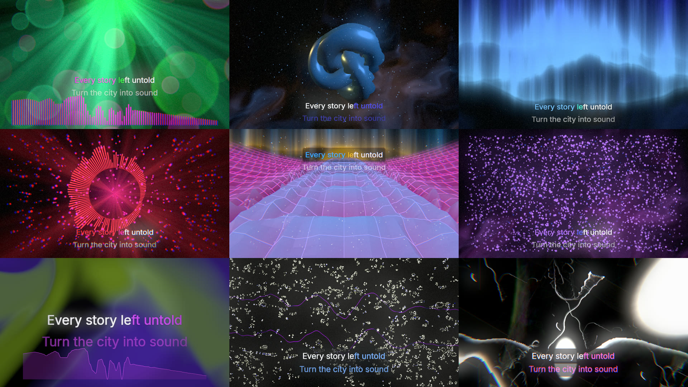
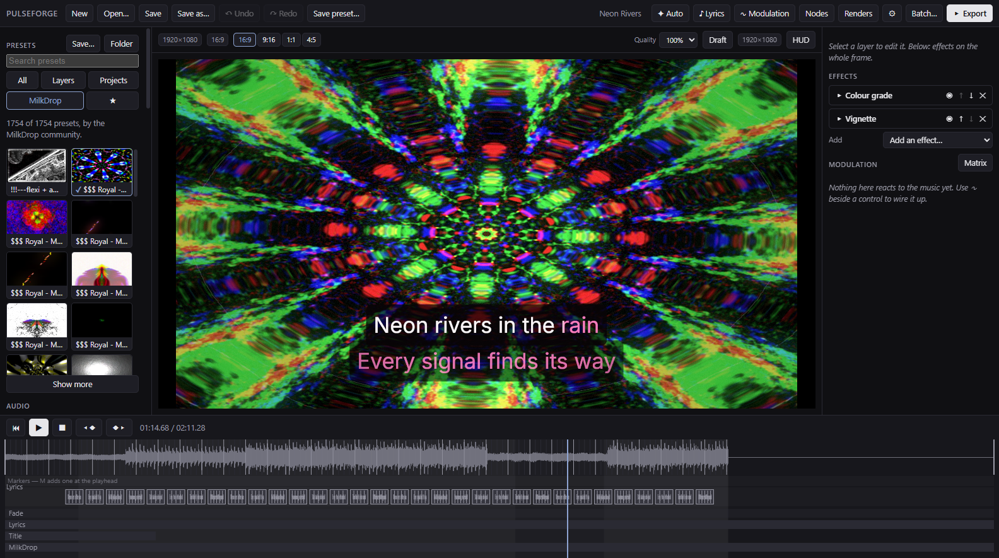
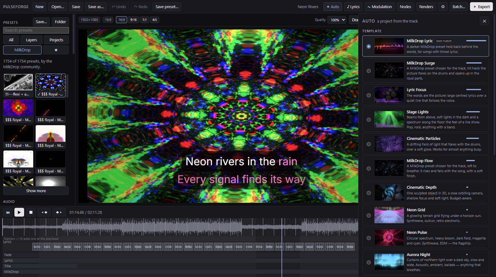
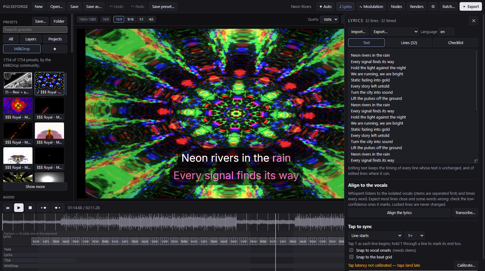
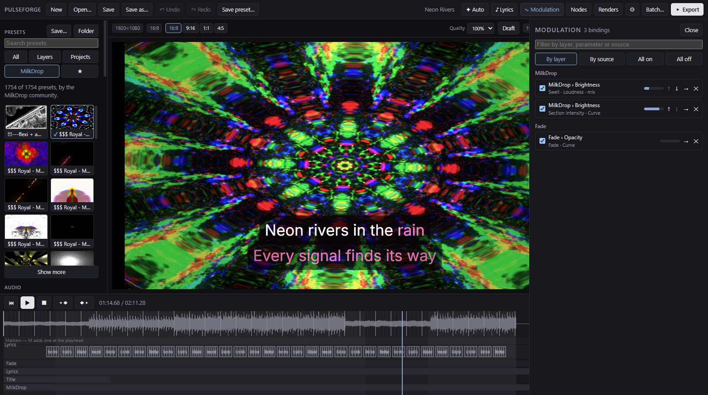
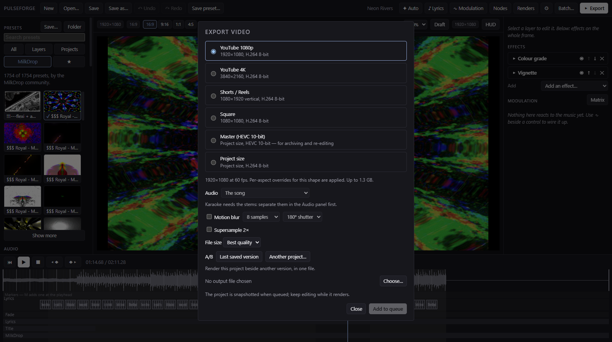
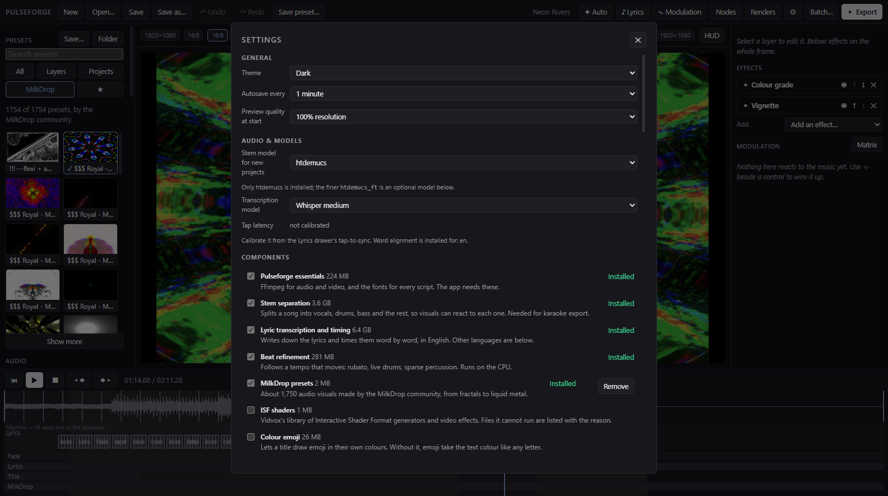

# Pulseforge

> **This is the `macos` branch:** the source of the Mac build, for Macs with Apple Silicon (M1 or newer, macOS 14+).
> It is kept apart from `main`, the Windows build, on purpose. To build the DMG yourself on a Mac: `npm ci`, then
> `npm run dist:mac`. On a Mac, video encodes on VideoToolbox, stems separate on the GPU through Metal, and
> transcription runs on the processor.

**Turn a song into a music video, on your own computer.**

Pulseforge listens to a track, builds a look that moves with it, and renders a finished MP4 at up to 4K60.
It is free, it works offline, and nothing you make ever leaves your machine: no account, no credits, no
upload, no watermark.



**[Download for Windows](https://github.com/damiaan111/pulseforge/releases/latest)** ·
[Mac preview (Apple Silicon)](https://github.com/damiaan111/pulseforge/releases) ·
[Install](#install) · [Your first video](#your-first-video) · [What it can do](#what-it-can-do) ·
[Help](#if-something-goes-wrong) · [Privacy and security](#privacy-and-security)

---

## What it is

Most music visualizers run in a browser, on somebody else's servers and somebody else's terms: render
credits, upload limits, a queue. Pulseforge is a desktop app that does the same job on the graphics card
you already own.

- **One click to a finished look.** Import a song and the Auto panel shows what twelve different looks
  would make of *your* track. Pick one, press Generate, and it is done.
- **It really follows the music.** Not just loudness: beats, drums, bass, vocals and the song's sections
  each drive their own part of the picture, so a video builds, drops and changes colour at the chorus.
- **Lyrics and karaoke.** It can write down the lyrics and time every word, then fill the words in as they
  are sung.
- **Everything stays editable.** What Auto builds is an ordinary project of layers. Change anything, undo
  anything.
- **Real exports.** Landscape, vertical and square from one project, in H.264 or HEVC, with a render queue.

## Screenshots

| | |
|---|---|
|  **The studio:** preview, layers, timeline |  **Auto:** every look, shown on your song |
|  **Lyrics:** transcribe, time and correct |  **Modulation:** what the music drives |
|  **Export:** shapes, file size, motion blur |  **Settings:** add or remove components |

The song and lyrics in these pictures were made up for them.

---

## Install

### What you need

| | Windows | Mac (preview) |
|---|---|---|
| **System** | Windows 10 or 11, 64-bit | macOS 14 or newer, Apple Silicon (M1 or newer) |
| **Graphics** | Any card that runs WebGL2. An NVIDIA card makes exports faster and is needed for stems and lyrics | Built in |
| **Disk space** | About 1 GB for the basics, up to 15 GB with everything | The same |

You do not need to install Python, FFmpeg or anything else yourself.

### Windows

1. Download **`Pulseforge-Setup-<version>.exe`** from the
   [latest release](https://github.com/damiaan111/pulseforge/releases/latest).
2. Run it. It installs for your user only and needs no administrator rights.
3. Windows may show *"Windows protected your PC"*, because the installer is not code-signed.
   Choose **More info**, then **Run anyway**.
4. Start Pulseforge from the Start menu or the desktop shortcut.

### Mac

The Mac build is a preview: it is built and tested automatically, but has been used by few people.

1. Download the **`.dmg`** from the [releases page](https://github.com/damiaan111/pulseforge/releases)
   (the one marked *for Mac*).
2. Open it and drag **Pulseforge** onto **Applications**.
3. The first time, macOS blocks it, because it is not signed with an Apple Developer ID. Open
   **System Settings → Privacy & Security**, scroll to *"Pulseforge" was blocked*, and choose **Open Anyway**.

### The first start: choose your components

Pulseforge asks once which parts you want. They are downloaded from their original sources and checked
before use. You can add or remove them later in **Settings → Components**.

| Component | What it adds | Size |
|---|---|---|
| **Essentials** | FFmpeg and fonts. Required | about 220 MB |
| **MilkDrop presets** | About 1,750 audio visuals made by the MilkDrop community | 2 MB |
| **Stem separation** | Splits a song into vocals, drums, bass and the rest, so each drives its own thing. Needed for karaoke | about 3.6 GB |
| **Lyric transcription and timing** | Writes down the lyrics and times every word | about 6.4 GB |
| **Beat refinement** | Follows a tempo that speeds up and slows down | about 280 MB |
| **Colour emoji, ISF shaders, extra models** | Optional extras | small to 3 GB |

**Essentials and MilkDrop presets are enough to make a video.** Start there and add the rest when you want it.

On Windows, stems and lyrics need an NVIDIA card with driver 580 or newer; the chooser tells you what it
found. On a Mac, stems use the built-in GPU and lyrics run on the processor, which takes a few minutes a song.

### Check your download (optional)

Every release lists the SHA-256 of its file. To be sure yours is the real one, compare:

```
Get-FileHash .\Pulseforge-Setup-<version>.exe -Algorithm SHA256      Windows PowerShell
shasum -a 256 Pulseforge-<version>-arm64.dmg                         Mac Terminal
```

### Updating

**Settings → Check for updates** looks for a newer version when you press it, shows what changed, and
installs it. Your components, projects and settings stay.

---

## Your first video

1. Press **Import audio…** and choose a song. MP3, WAV, FLAC, M4A and video files all work.
2. Wait a few seconds while the song is analysed. The **Auto** panel opens with a small picture of what
   each look would make of your song.
3. Pick one and press **Generate project**. Press the **space bar** to watch it.
4. Not quite right? **Surprise me** rolls another take of the same look. The last ten stay as thumbnails
   you can go back to.
5. Press **Export**, choose where to save, and press **Add to queue**. When the queue says **Done**, your
   video is ready.

**Want lyrics on screen?** Open **Lyrics** and either paste them, import a `.lrc` or `.srt` file, or press
**Transcribe** to have them written down for you. Then Generate again: the look makes room for them.

---

## What it can do

### Looks

Twelve templates, each a starting point that adapts to the song's colours, tempo and structure:

| | |
|---|---|
| **MilkDrop Flow, Surge, Lyric** | A MilkDrop preset chosen to suit the track: calm, hard-hitting, or held back behind the words |
| **Neon Pulse** | A circular spectrum in beams of light. Electronic, synthwave |
| **Neon Grid** | A glowing landscape under a horizon sun and northern lights |
| **Stage Lights** | Beams from above, soft lights and a spectrum along the floor: a live show |
| **Aurora Night** | Curtains of northern light over a dark sky. Quiet songs, ballads |
| **Cinematic Depth** | One sculpted 3D object in a nebula, with shallow focus |
| **Cinematic Particles** | A drifting field of light that flares with the drums |
| **Lyric Focus** | The words are the picture, over slow folds of colour |
| **Minimal Type, Minimal Mono** | Typography and one thin line of sound, and nothing else |

### Building your own

- **Layers:** fifteen visualizers, three 3D scenes, five atmospheres (Nebula, Aurora, Bokeh, Light rays,
  Silk), images, video backgrounds, titles and logos. Each has its own position, blend mode and effects.
- **Effects:** bloom, depth of field, colour grading and LUTs, film grain, glitch, chromatic aberration,
  kaleidoscope and more, on one layer or on the whole frame.
- **Your own shaders:** paste a shader from Shadertoy, or drop an ISF or GLSL file into the modules folder.
  Its controls build themselves.

### Making it move with the music

- **Every control has a ∿ button.** Choose what drives it: the kick, the bass, the vocals, loudness, a
  frequency band. One-click recipes like "kick pump" do it for you.
- **Stems:** with stem separation, the kick can drive the size while the vocal drives the glow.
- **Sections:** intro, build, main part and outro are found automatically, and looks change with them.
- **Keyframes and markers:** animate anything by hand, with easing and a curve editor.
- **MIDI files** can drive parameters note by note.

### Lyrics and karaoke

- Transcribe and time every word automatically, or paste lyrics and tap along.
- Seven ways for words to fill in as they are sung.
- Right-to-left text, Chinese, Japanese, Korean and Thai, with fonts for every script.
- **Karaoke export:** the song without its vocals, with the words on screen.

### Export

- MP4 up to **4K at 60 frames a second**, in H.264 or 10-bit HEVC.
- **Landscape, vertical and square** from the same project.
- **File size:** Balanced by default (about 20 Mbit/s at 1080p60), with Best for archiving and Small for sharing.
- A **render queue** you can keep working beside, and a **batch mode** that turns a folder of songs into a
  folder of videos overnight.
- Film-like **motion blur** and 2× supersampling.
- What you see in the preview is exactly what is exported, frame for frame.

### Handy keys

| Key | Does |
|---|---|
| **Space** | Play and pause |
| **Ctrl+Z**, **Ctrl+Shift+Z** | Undo, redo (⌘ on a Mac) |
| **Ctrl+S**, **Ctrl+E** | Save, export |
| **M** | Drop a marker at the playhead |
| **[** and **]** | Jump between markers |

---

## If something goes wrong

- **Windows says the app is not recognised.** The installer is not code-signed. Choose **More info**, then
  **Run anyway**. [Check the download](#check-your-download-optional) first if you want to be sure.
- **macOS says Pulseforge cannot be opened.** **System Settings → Privacy & Security → Open Anyway**.
- **A component will not install.** That one step needs the internet. Press Install again: finished
  downloads are kept and it resumes. **Settings → Setup & repair → Verify installation** checks every file.
- **Stems or lyrics are greyed out.** On Windows they need an NVIDIA card with driver 580 or newer.
  Everything else works without one.
- **The preview stutters.** Press **Draft** above the preview. Exports still use full quality.
- **Exports are too large.** Choose **Small file** under **File size** in the export dialog.
- **Something else.** **Settings → Diagnostics → Copy diagnostics** copies a report. Read it before you
  share it, because it names folders on your computer, then
  [open an issue](https://github.com/damiaan111/pulseforge/issues).

**Uninstalling.** On Windows use **Settings → Apps**; on a Mac drag Pulseforge to the Bin. The downloaded
components and your settings stay behind so a reinstall is quick. To remove everything, delete
`%LOCALAPPDATA%\Pulseforge` and `%APPDATA%\Pulseforge` on Windows, or
`~/Library/Application Support/Pulseforge` on a Mac.

## Privacy and security

- **Nothing leaves your computer.** No account, no telemetry, no analytics, no crash upload.
- **It goes online in two places only, and only when you ask:** installing components, each checked
  against a known checksum, and **Check for updates**.
- **The app's window cannot reach the internet at all.** It runs sandboxed, and every network request
  from it is refused.
- **Shaders you add** run on the graphics card and cannot read files or go online.
- Found a security problem? See [SECURITY.md](SECURITY.md).

---

## For developers

<details>
<summary><b>Running from source, commands, and how it is built</b></summary>

### From source

1. Download this repository (**Code → Download ZIP**, or `git clone`).
2. On Windows, double-click **`Pulseforge.cmd`**. It fetches Node.js if you do not have it, installs the
   packages and starts the app. Everything stays inside the folder.

Or by hand, with Node 22.18 or newer: `npm ci`, then `npm run dev`.

### Commands

| Command | What it does |
|---|---|
| `npm run dev` | Run the app, rebuilding on every change |
| `npm run check` | Typecheck, lint and run the tests |
| `npm run golden` | Re-render the reference frames and check nothing moved |
| `npm run render -- song.pvproj -o video.mp4` | Render a project without opening the app |
| `npm run batch -- <folder> -o <out>` | A video for every song in a folder |
| `npm run setup -- --help` | The component installer on the command line |
| `npm run modules:check` | Check the shader modules in `modules/` |
| `npm run dist` | Build the Windows installer into `release/` |
| `npm run dist:mac` | On a Mac: build the DMG into `release/` |

`npm run render` takes `--aspect 9:16`, `--size 3840x2160`, `--codec hevc`, `--quality best|balanced|small`
and `--seconds 30`, among others.

### How it is built

Electron, TypeScript and WebGL2, with a Python process for Demucs and WhisperX, and FFmpeg for encoding.

```
Shell     Electron: windows, files, FFmpeg, the render queue, the Python process
Studio    React: the timeline, the inspector, the preview
Engine    Pure rendering: a project and a moment in time in, a frame out
```

**The one rule:** the same project and the same moment always give exactly the same frame. The engine may
not read the clock or use ordinary randomness; time is passed in, and randomness comes from a seed in the
project. That is why the preview and the export cannot drift apart, and the tests prove it by comparing
renders byte for byte.

Measured on an RTX 3060: 1080p60 H.264 at about 209 frames a second, 4K60 at 56, and a four minute song
split into stems in under nine seconds.

### Where things live

```
src/engine/     the renderer            src/ui/         the studio
src/analysis/   beats, sections, key    src/shell/      Electron's main process
src/director/   the auto-director       src/export/     frames to FFmpeg, the queue
src/project/    the project file, undo  python/         Demucs and WhisperX
templates/      the looks, as JSON      modules/        drop your own shaders here
setup/          the component installer docs/           specifications and build notes
```

Projects are `.pvproj` files: plain JSON you can read, diff and keep in git.

### Documentation

| File | What is in it |
|---|---|
| [CHANGELOG.md](CHANGELOG.md) | What changed, version by version |
| [docs/module-authoring.md](docs/module-authoring.md) | Writing your own visualizer or effect: a JSON file and a shader |
| [PROJECT.md](PROJECT.md) | The original plan and its decisions |
| [docs/STATUS.md](docs/STATUS.md), [docs/ROADMAP.md](docs/ROADMAP.md) | The build log, and what is left |
| `docs/*-spec.md` | The specification of each part |

</details>

## Good to know

- Pulseforge is one person's project, tested on Windows with an RTX 3060. A PC without an NVIDIA card
  should work, with slower exports and without stems and lyrics, but has seen little use.
- Live input, WebGPU and NDI or Spout output are left out on purpose.
- There is no support desk, but [issues](https://github.com/damiaan111/pulseforge/issues) are read.

## Licence and credits

Pulseforge is released under the [MIT licence](LICENSE).

It stands on other people's work, each under its own licence: MilkDrop visuals through
[Butterchurn](https://github.com/jberg/butterchurn), [FFmpeg](https://ffmpeg.org),
[Demucs](https://github.com/facebookresearch/demucs), [WhisperX](https://github.com/m-bain/whisperX),
[three.js](https://threejs.org) and [Electron](https://www.electronjs.org). The full list is written to
`vendor/LICENSES.md` when components are installed.

Two things to know before commercial use: the word-timing models for French, German, Spanish and Italian
are for non-commercial use (CC BY-NC 4.0) and are only installed if you choose them, and the MilkDrop
presets are the work of many artists, so check before using one commercially.
