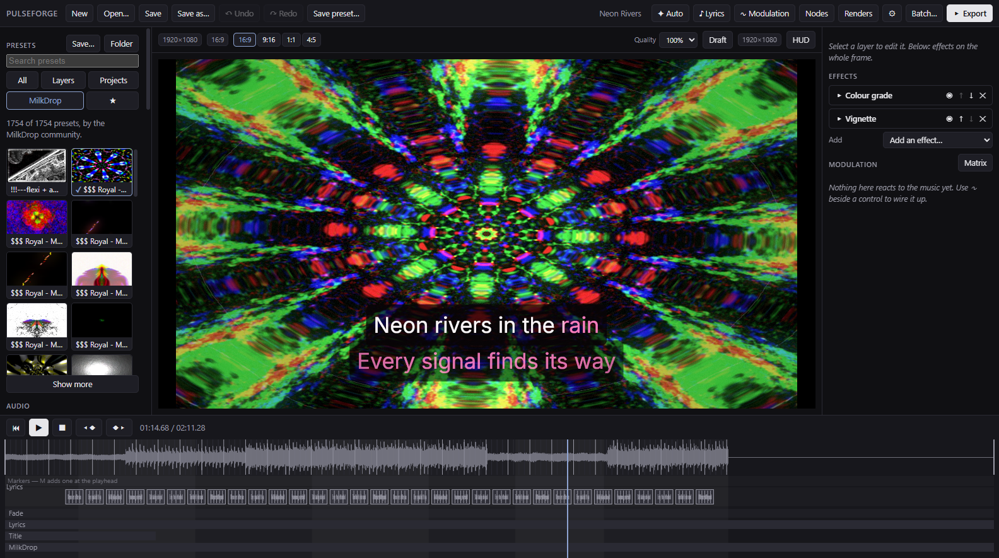
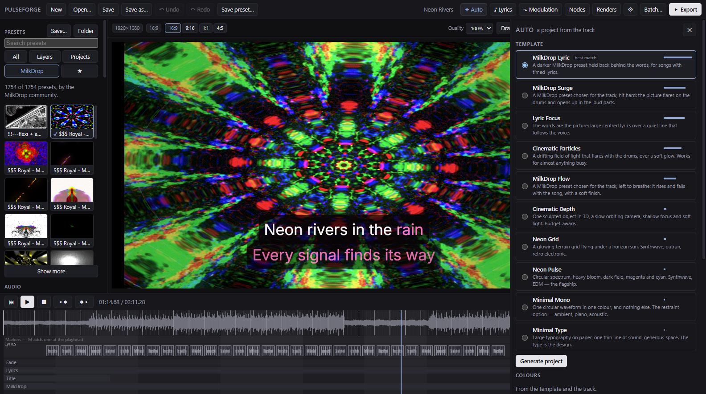
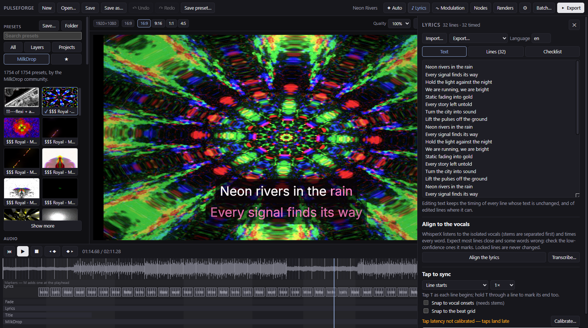
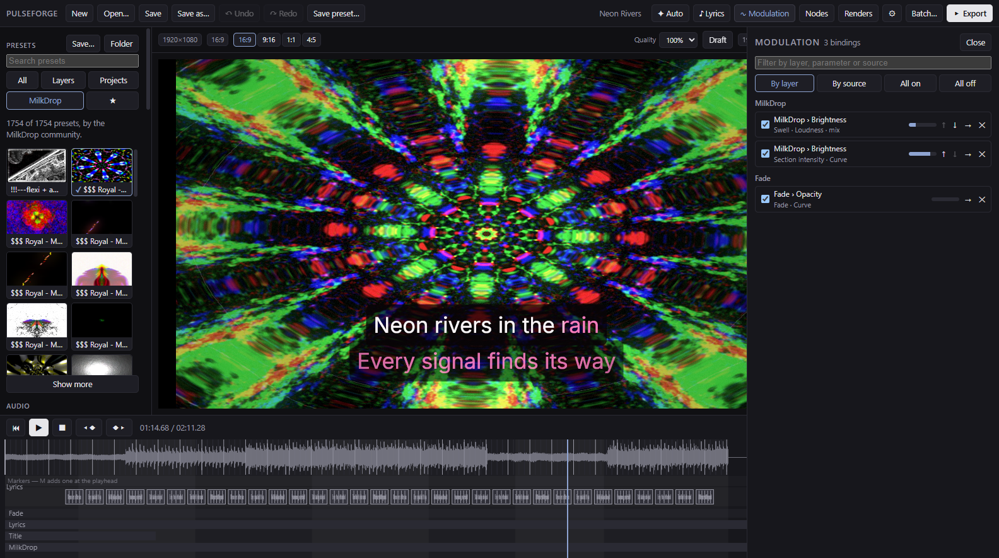
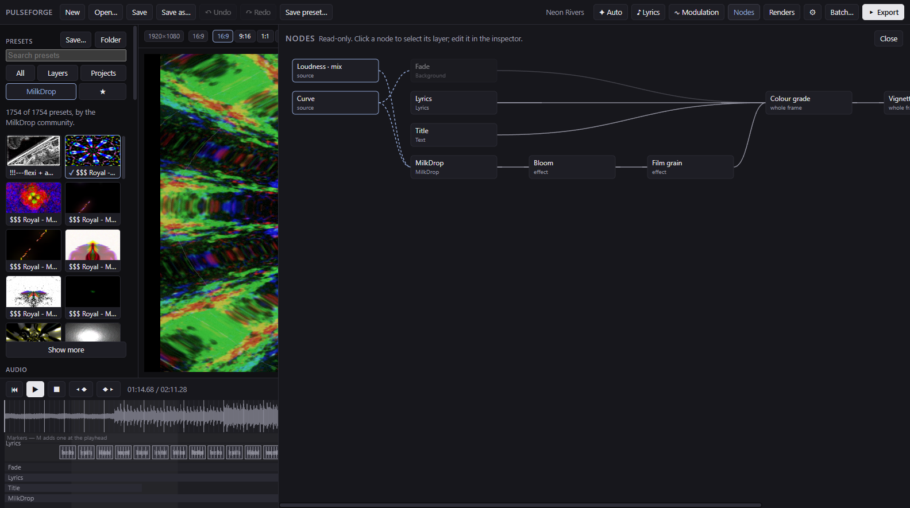
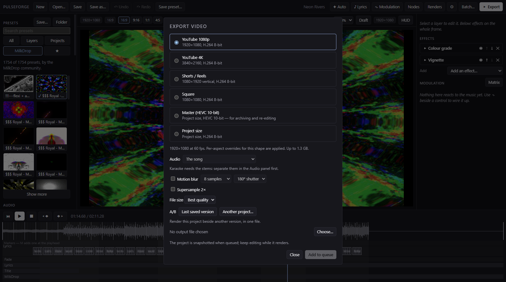
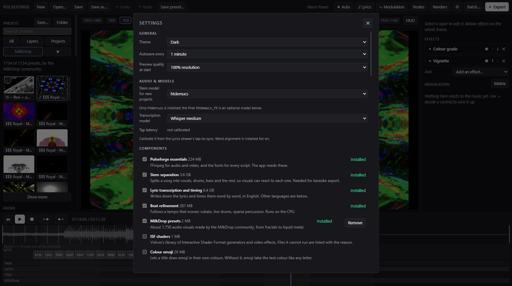
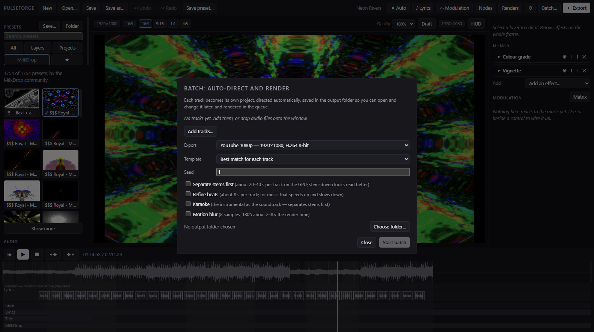
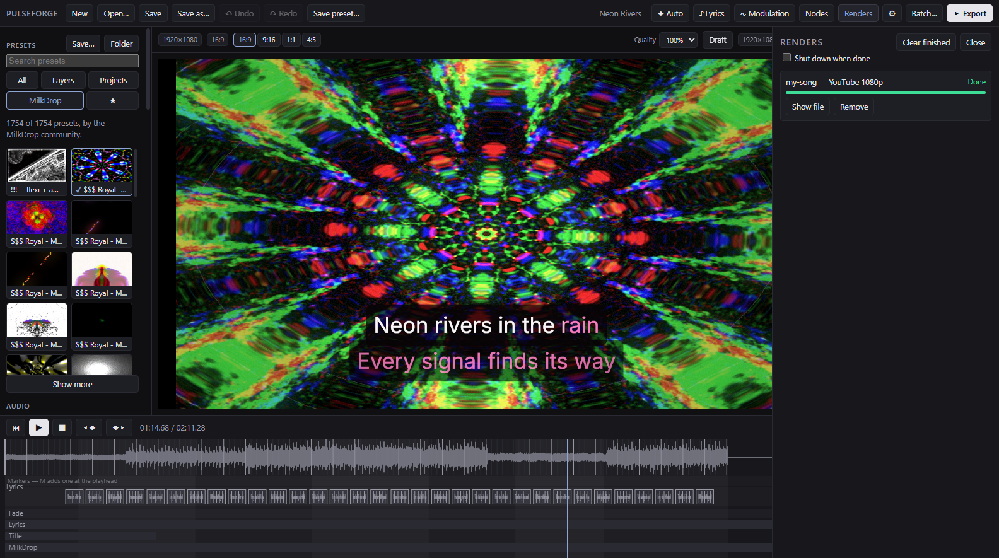

# Pulseforge

Turn a song into a music video, on your own machine, with your own GPU doing the work.



Local, offline after setup, and free. No account, no credits, no uploads, no watermark.

**Windows 10/11, 64-bit** · Electron, TypeScript and WebGL2, with Demucs and WhisperX on the side, and FFmpeg for export · [MIT](LICENSE)

## Contents

[Features](#features) · [Screenshots](#screenshots) · [Install](#install) · [Running it](#running-it) · [How it works](#how-it-works) · [Where the build is right now](#where-the-build-is-right-now) · [Documentation](#the-documentation)

## Features

**Visuals**
- About 1,750 MilkDrop presets through Butterchurn, searchable, with a picture of each
- Ten built-in visualizers, three 3D scenes, images, video backgrounds, text and logos
- Layers with transforms, blend modes, groups and masks, with effect chains on each layer and on the whole frame
- Depth of field, bloom, LUTs and more; film-like motion blur and 2× supersampling on export
- Your own shaders: `.glsl` from Shadertoy, ISF `.fs` files, or a module with a small JSON file. The controls build themselves
- Vertical titles, 3D extruded titles that follow the beat, and colour emoji in titles

**Music reaction**
- Any audio feature can drive any parameter, with a one-click recipe or shaped by hand
- Stems: vocals, drums, bass and other (six stems with the optional model), so each part drives its own thing
- Beats, onsets, sections, tempo and the musical key are analysed up front
- MIDI files drive parameters note by note
- Keyframes with easing and a curve editor, markers that layers can react to, and a modulation matrix
- A read-only node view of the whole project

**Lyrics and karaoke**
- Transcribe with WhisperX and time every word, or paste lyrics and tap along
- Words fill in as they are sung, in seven styles; the vocals are drawn behind the lyric lane
- Right-to-left text, CJK and Thai line breaks, with bundled fonts for every script
- Karaoke export: the instrumental, with the words on screen

**Auto-director**
- Ten templates ranked for the song; a project in one click, with the decisions listed so you can see why
- Every result is an ordinary project: nothing is locked, and undo works
- Surprise Me rolls another take and keeps what you edited or locked
- Colours from the track, an image or the song's cover art, with palette shifts at a chorus
- Save a project as your own template with Extract

**Export**
- MP4 to 4K60: H.264 and HEVC on NVENC, H.264 on the CPU where there is no usable card
- Landscape, vertical and square from one project
- File size choice: best quality, balanced or small
- A render queue, a batch mode for whole folders, a command line, and an A/B render of two versions side by side
- Every frame is deterministic: the same project gives the same pixels

**Looking after itself**
- A real Windows installer, with `.pvproj` files opening in the app
- Choose what to install and where it goes; remove components from the app again
- Autosave with crash recovery; the preview comes back after a graphics driver reset
- A performance HUD, draft preview, and storage and log views

## Screenshots

| | |
|---|---|
|  **Auto-director:** templates ranked for the song |  **Lyrics:** timing, checking and correcting |
|  **Modulation matrix:** every connection in one place |  **Node view:** how the project fits together |
|  **Export:** shapes, file size, range and motion blur |  **Settings:** add or remove components |
|  **Batch:** a folder of songs, a video each |  **Renders:** a queue you can keep working beside |

The song and lyrics in these pictures were made up for them.

## What it is

Pulseforge is a desktop app that takes an audio file and renders a finished music video from it.
You build the look out of layers, you wire the music into it so things actually move with the
track, and then you export a real MP4 at up to 4K60, on your graphics card's encoder if it has a
usable one and on the CPU if it does not.

It runs entirely on your own computer. No account, no credits, no upload limit, no watermark, no
queue except the one you make yourself. After the first setup it works with the network cable
pulled out.

## Why I built it

There are good tools for this already, like Vizzy and Shimga. They look great and they work. The
problem is that they run in somebody else's browser, on somebody else's terms. You get render
credits, ad block detection, upload caps and a wait in a queue behind everyone else.

I have a machine with an RTX 3060 sitting right here doing nothing while a website tells me to
wait. So the idea was simple. Take the parts of those tools that are genuinely good, run them
locally, and let the GPU I already paid for do the rendering.

## What you can do with it

**Build a look out of layers.** Visualizers, backgrounds, text, logos and 3D scenes stack on top
of each other. Every layer has its own transform, blend mode, opacity and chain of effects. You
can group layers together and treat the group as one thing.

**Make it react to the music properly.** This is the part that matters. Any audio feature can
drive any parameter. Not just overall loudness, which is what makes most visualizers look like
one dumb throb. The track gets split into stems, so the kick can drive the scale while the
bassline drives the hue and the vocal drives the glow, all at once and none of them fighting over
the same frequencies.

**Time lyrics and karaoke.** Paste your lyrics, tap along with the track to set the timing, or let
the machine take a first pass at it with WhisperX and correct what it got wrong. Words fill in as
they are sung. The vocal stem shows up as a waveform behind the lyrics track, which makes lining
them up far easier than guessing against a full mix.

**Let it build the first version for you.** Auto mode analyses the track, works out what kind of
music it is, picks a look that suits it and wires everything up with sensible amounts already
dialled in. What comes out is a normal project. Nothing is locked, nothing is hidden. Edit it,
delete bits of it, or hit Surprise Me and roll a completely different look from the same song.

**Export properly.** One project gives you landscape, vertical and square out of the same edit,
because layers know how to move when the canvas changes shape. Queue up several exports and go to
bed.

## What you need

- **Windows 10 or 11**, 64-bit
- **Any graphics card with WebGL2.** With an NVIDIA card and driver 570 or newer, video encodes on
  the card with NVENC. Anywhere else it encodes H.264 on the CPU: about half the speed, a slightly
  larger file for the same quality, and no HEVC. The export dialog says which you are getting.
- **An NVIDIA card with driver 580 or newer** for stems and lyrics, which run on CUDA. The setup
  screen checks yours and says so before you download anything.
- **Disk space:** about 1 GB for the essentials, about 8 GB for stems, about 15 GB for everything
  apart from the optional models. Downloads are kept, so reinstalling never needs the internet.

One thing to know about the graphics card. Anything in the RTX 30 series can encode H.264 and
HEVC, but not AV1. That needs a 40 series card or newer. Pulseforge checks what your card can
actually do and disables what it cannot deliver, rather than letting you pick something that fails
twenty minutes into a render.

You do not need Node, Python, FFmpeg or git. The launcher fetches what is missing.

## Install

**The easy way:** run `Pulseforge-Setup-1.1.2.exe` from the
[Releases page](https://github.com/damiaan111/pulseforge/releases), or build it yourself with `npm run dist`; it lands in `release/`. It installs for you alone, needs no administrator rights, and adds a Start menu and desktop shortcut. The first
start offers the components. They go to `%LOCALAPPDATA%\Pulseforge` unless you choose another folder there, and uninstalling
leaves them. The installer is not code-signed, so Windows may warn the first time: choose More info, then Run anyway.

**From source:**

1. Download this repository (**Code → Download ZIP** on GitHub, or `git clone`) and unzip it
   anywhere you like.
2. Double-click **`Pulseforge.cmd`**.

The first start downloads Node.js if you do not have it, then the app's own packages, about 300 MB
in all. Then Pulseforge opens and asks what you want:

| Component | What it adds | Download |
|---|---|---|
| Essentials | FFmpeg and the fonts for every script. Required. | about 220 MB |
| Stem separation | Vocals, drums, bass and the rest, so visuals can react to each. Karaoke export. | about 3.6 GB |
| Lyric transcription and timing | Writes down the lyrics and times them word by word, in English. | about 6.4 GB |
| Beat refinement | Follows a tempo that moves. Runs on the CPU. | about 280 MB |
| MilkDrop presets | About 1,750 audio visuals made by the MilkDrop community. | about 2 MB |
| Colour emoji | Lets a title draw emoji in their own colours. | about 25 MB |
| ISF shaders | Vidvox's generators and video effects (MIT). About 105 of its 327 files run here; the rest are listed with the reason. | under 1 MB |
| Optional models | Finer stems, six stems, a larger transcription model, word timing for French, German, Spanish and Italian. | 0.05–3 GB each |

Tick what you want and press **Install**. It can be stopped and resumed, and every file is checked
against a known checksum. You can add more at any time in **Settings → Components**.

**Updates:** Settings → **Check for updates** asks GitHub for a newer release, only when you press it, and installs it
over this version after checking its SHA-256. Nothing else in Pulseforge goes online.

**A licence to be aware of:** the French, German, Spanish and Italian alignment models are licensed
CC BY-NC 4.0, for non-commercial use. They are never installed unless you choose them and confirm
that you have read the notice. English alignment is not affected.

Your own Python and FFmpeg are left alone. Running from source, everything stays in this folder, so
deleting it removes all of it. Once the download has finished, the app never reaches out to the
internet again, unless you press Check for updates.

## Running it

Installed, use the Start menu or desktop shortcut, or double-click a `.pvproj` file. From source,
double-click `Pulseforge.cmd`. To open a project, pass it along:

```bash
Pulseforge.cmd song.pvproj
```

Pulseforge is a desktop app, so there is no server to start and no address to open in Chrome. The
window is Chromium underneath, which is where the WebGL rendering happens.

If you are working on Pulseforge itself, `npm run dev` runs it with a rebuild on every change, and
`npm run setup -- --help` shows the command-line version of the setup screen.

### Rendering without opening the app

Everything the app can render, the command line can render too. This is the useful one for batches
and for leaving something going overnight.

```bash
npm run render -- song.pvproj -o out/video.mp4
```

Some things you can pass it:

| Flag | What it does |
|---|---|
| `--aspect 9:16` | Render vertical instead of the project's own shape |
| `--size 3840x2160` | Pick the resolution yourself |
| `--codec hevc` | HEVC instead of H.264, better quality per megabyte |
| `--quality balanced` | A smaller file: `balanced` or `small`. The default is `best` |
| `--seconds 30` | Only render the first thirty seconds, handy for checking a look |
| `--audio other.wav` | Swap the audio without touching the project |
| `--no-cache` | Analyse the audio again instead of reading the cached analysis |

### The other commands

| Command | What it does |
|---|---|
| `npm run check` | Typecheck, lint and run the test suite |
| `npm run golden` | Re-render the reference frames and check nothing moved |
| `npm run modules:check` | Check the modules in `modules/`: they compile, render the same twice, and fit every aspect |
| `npm run milkdrop:measure` | Measure every MilkDrop preset for the auto-director's catalogue |
| `npm run contact-sheet -- <folder>` | Run every auto template on every track in a folder; a grid of stills in `out/contact-sheet/` |
| `npm run validate` | The full hardware validation run, writes a report to `out/validate/` |
| `npm run build` | Bundle the app without launching it |
| `npm run dist` | Build the Windows installer into `release/` |

## How it works

There are three parts, and keeping them separate is what makes everything else possible.

```
  Shell            Electron. Windows, files, FFmpeg, the render queue, talking to Python.
    |
  Studio           React. The timeline, the inspector, the canvas, everything you click.
    |
  Engine           Pure rendering. Give it a project and a moment in time, get a frame.
                   Knows nothing about Electron, the DOM, or what time it is.
```

Alongside those sits a small Python process that handles the machine learning work, splitting
tracks into stems with Demucs and timing lyrics with WhisperX. It stays running between jobs so
you do not pay four seconds of startup every single time, and it shuts itself down when it has
been idle for a while so the renderer gets its video memory back.

### The one rule everything is built on

Give the engine the same project and the same moment in time, and it has to produce exactly the
same frame. Every time, on any run, no matter how fast or slow the machine happens to be.

That sounds like a technicality. It is actually the whole design. It means there is no separate
"preview renderer" and "export renderer" that can drift apart and make your final video look
different from what you were looking at while you built it. There is one renderer. The preview
calls it at whatever speed your screen can manage, and the export calls it at exactly one frame at
a time. Same code, same numbers, same pixels.

To keep that true, the engine is not allowed to ask what time it is, and it is not allowed to use
ordinary randomness. Time always arrives as a value handed in from outside. Randomness comes from
a seed stored in the project, so the same seed gives you the same result forever. The audio
analysis is worked out up front and stored, so the preview and the export are reading identical
numbers rather than sampling live audio and getting slightly different answers.

The tests check this by rendering the same clip twice and comparing the files byte for byte.

### What it does when it exports

The audio gets analysed once and cached. Then for each frame in turn, the engine renders it, the
result is pulled off the graphics card, converted, and pushed straight into FFmpeg, which hands it
to the hardware encoder on your GPU. The audio gets muxed in at the end.

Nothing races the clock. A frame that takes a long time just takes a long time. Slow is fine,
wrong is not, and that is the trade that makes the output trustworthy.

Measured on the RTX 3060 with a six layer project:

| | Speed |
|---|---|
| 1080p60, H.264 | 209 fps, so roughly three and a half times faster than realtime |
| 4K60, H.264 | 56 fps |
| 4K60, HEVC 10-bit | 27 fps |
| 1080p60 with a 3D scene and depth of field | 155 fps |
| Splitting a four minute track into stems | 8.6 seconds |

## Where things live

```
src/engine/      The renderer. Pure, no Electron, no DOM, no clock.
src/analysis/    Reading audio, FFT, beats, onsets, sections, the analysis cache.
src/project/     The project file, undo, presets, turning a document into something renderable.
src/export/      The frame pump, FFmpeg, the render queue.
src/ml/          Talking to the Python process.
src/shell/       Electron's main process.
src/ui/          The studio.
python/          The Python side, Demucs and WhisperX.
modules/         Drop your own visualizers and effects in here, no rebuild needed.
templates/       The auto director's looks, as JSON. Your own go in Documents/Pulseforge/Templates.
src/director/    The auto director: matching, palettes, calibration, arrangement, the decision log.
docs/            Specifications, decisions and build status.
vendor/          Everything setup downloaded. Not in git, rebuild it any time.
```

Your projects are `.pvproj` files, which are just JSON. You can read them, diff them, keep them in
git and fix one wrong value in a text editor if you ever need to.

## Where the build is right now

Being straight about this.

**Working:** the studio. Import a track, build a look from ten visualizers, ten effects plus depth
of field, backgrounds (colour, gradient, image or video), text, logos, groups and three 3D scenes
(a reactive shape, a synthwave terrain, a city of bars), reskin it with the palette, browse and save
presets with animated thumbnails, preview it against the audio, and queue renders in any aspect,
on NVENC where the card allows it and on the CPU where it does not. Underneath: the deterministic engine, the project format with undo, the modulation
evaluator, audio analysis with beats and sections, stem separation, drop-in shader modules, and a
command line that renders a project without opening anything.

**Wiring the music in:** every control has a ∿ button. Pick what drives it (onsets, the beat grid,
a frequency band, loudness, brightness, an LFO…) or a one-click recipe like "kick pump", then shape
it with amount, curve, attack and release, and watch the slider move with the track. A matrix panel
shows every connection in the project in one place.

**Stems:** one click splits the track into drums, bass, vocals and other on your GPU (seconds, not
minutes), and from then on any layer or connection can listen to one of them — the kick drives the
scale while the vocal drives the glow.

**Autosave:** unsaved work is snapshotted every minute and before a preset is applied. If the app
ever dies, the next start offers the work back, says when it was saved and what differs from the
file on disk, and lets you restore or discard it. If only the studio window crashes, it comes back
by itself with the same offer. Crash dumps stay on your disk and are never sent anywhere.

**Lyrics:** paste them or import a subtitle file, then let WhisperX time every word from the
isolated vocals in about a minute, or tap along yourself. Correct anything on the lyrics lane
of the timeline, with the vocals drawn behind it. Words fill in as they are sung, in seven styles.

**MilkDrop:** the Presets panel opens on about 1,750 visuals by the MilkDrop community, with search
and a picture of each. They render byte-identically from one run to the next, like everything else.
23 presets ask for texture files nobody shipped: the part that cannot run falls back to the default, and
the layer says so.

**Auto:** import a track into an empty project and it offers to build one. Ten templates (three
built on MilkDrop, then Neon Pulse, Neon Grid, Minimal Type, Minimal Mono, Cinematic Depth, Cinematic
Particles and Lyric Focus) are ranked for the song. With MilkDrop installed, the director picks a
preset that suits the track: every preset has been rendered and measured, so busy songs get busy
pictures, dark songs dark ones, and the ones that stay black or strobe are never chosen. The one you pick gets a palette, layers and connections calibrated to that
track, sections that build and drop, and a title that clears before the singing starts. A "why it
looks like this" list explains every choice. Surprise Me rolls another take while keeping anything
you have edited, and anything you lock (palette, layout, motion, template). The last ten rolls
stay as thumbnails you can go back to.

**Looking after itself:** a Settings screen (theme, autosave, models, the export default), setup
verify and repair from inside the app, a Storage view that shows what the cache holds, per track,
with a size limit and one-click cleanup, and logs plus "copy diagnostics" for when something
goes wrong.

**Optional extras:** a finer stem model, a six-stem model that adds guitar and piano, the larger Whisper model, and word timing for French,
German, Spanish and Italian, each installed with one click in Settings (or `npm run setup -- --tier
extras`). `npm run setup -- --rebuild-check` proves the whole Python side can be rebuilt with no
internet.

**Animation and finish:** keyframe any parameter, opacity or transform, with easing presets and a
curve editor, in the inspector and on the timeline. Mask any layer by another's shape or
brightness, inverted and feathered. Export with film-like motion blur (a tick box in the export
dialog, or `--motion-blur` on the command line).

**Batch:** drop a stack of tracks onto the window (or `npm run batch -- <folder> -o <out>`), and
each becomes its own auto-directed project and video, rendered one after another, with a
notification when they are done and, if you ask, the computer shutting down after.

**Markers:** press M to drop a named, coloured marker at the playhead. Everything on the timeline
snaps to markers, [ and ] jump between them, an export can render just the part between two of
them, and a layer can react to them — a flash at every scene change.

**Karaoke:** once a track's stems are separated, export it with the instrumental as the soundtrack —
the song without its vocals, with the lyrics on screen.

**Performance HUD:** see what each layer costs on the GPU while you edit, and what that means at
4K, before you commit to a long render. Every render report lists the per-layer cost too.

**Shadertoy:** paste a shader from shadertoy.com (it checks as you type) or drop a `.glsl` file in
`modules/`, and it becomes a layer — `iTime`, `iResolution` and the music as `iChannel0` work as on
the site.

**LUTs:** grade a layer or the whole frame with any `.cube` file — a film emulation, a show look — at
any strength.

**Draft mode:** one click renders the preview at 640 px with the costliest effects approximated,
so heavy projects stay smooth while you edit — exports always use full quality.

**New in 1.1:** ISF shaders, vertical and 3D titles, colour emoji in titles, MIDI files as a
modulation source, combining audio files into one track, a video file as the audio, A/B renders, the
node view, colours from an image or cover art, palette shifts, Extract as template, and a choice of
file size.

**Known limits:** it has been used by one person on one PC, with an RTX 3060. A PC without an NVIDIA
card has not been tried. The installer is not code-signed, so Windows warns about it. Live input,
WebGPU and NDI/Spout are left out on purpose. The reasons are in `docs/ROADMAP.md` §6.

Every Must-have and Should-have is done. `docs/ROADMAP.md` has every requirement with its state and
what is left. `docs/STATUS.md` has the detailed version, down to what has been verified on real
hardware and how.

## The documentation

The design was written before the code, and it is all in the repo.

| File | What is in it |
|---|---|
| `CHANGELOG.md` | What changed, release by release. |
| `PROJECT.md` | The whole plan. What it is, what it needs, what it will never do. |
| `docs/STATUS.md` | Where the build actually is. Read this first if you are picking it up. |
| `docs/ROADMAP.md` | Every requirement, done or not, and what gets built next. |
| `docs/module-authoring.md` | How to write your own visualizer or effect for `modules/`. |
| `docs/decisions.md` | Every decision that got made, and why. |
| `docs/module-spec.md` | How a visualizer or effect is put together. |
| `docs/modulation-spec.md` | How audio drives parameters. |
| `docs/auto-director-spec.md` | How the automatic mode decides things. |
| `docs/export-spec.md` | The render pipeline in detail. |
| `docs/lyrics-spec.md` | Lyrics and karaoke. |
| `docs/compositor-spec.md` | How layers get combined into a frame. |
| `docs/ui-spec.md` | The studio interface. |
| `docs/data-formats-spec.md` | File formats and how old projects keep working. |

## Licence

MIT: see [LICENSE](LICENSE). Do what you want with it.

That covers Pulseforge's own code. What the launcher downloads comes with its own licences, listed
in `vendor/LICENSES.md` after setup. In particular, the French, German, Spanish and Italian alignment
models are non-commercial (CC BY-NC 4.0), so they are never installed unless you choose them.

MilkDrop runs through [Butterchurn](https://github.com/jberg/butterchurn) (MIT). The presets are the work
of many MilkDrop artists: the package that collects them is MIT, but that may not speak for each author,
so check before using them commercially.

## Notes

This started as a personal project, built on my own hardware, and it is shaped around that. It is
not a product and there is no support, but it is built so anyone on Windows can download it and use it.

If you do end up poking at it, `docs/module-authoring.md` explains how to write your own visualizer
or effect: a small JSON file and a shader. Anything you drop into `modules/` gets picked up while
the app is running, and the settings panel builds itself from what your module says it has, so you
do not have to write any interface code to go with it. `modules/example-pulse-rings/` is a worked
example and `modules/_template/` a starting point.
