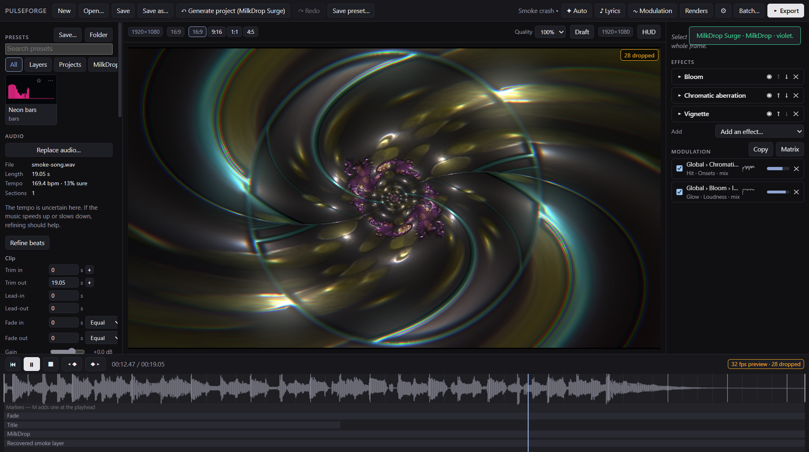

# Pulseforge

Turn a song into a music video, on your own machine, with your own GPU doing the work.

<!-- Drop the screenshot in and uncomment this line.

-->

## What it is

Pulseforge is a desktop app that takes an audio file and renders a finished music video from it.
You build the look out of layers, you wire the music into it so things actually move with the
track, and then you export a real MP4 at up to 4K60 using the hardware encoder on your graphics
card.

It runs entirely on your own computer. No account, no credits, no upload limit, no watermark, no
queue except the one you make yourself. After the first setup it works with the network cable
pulled out.

## Why I built it

There are good tools for this already, like Vizzy and Shimga. They look great and they work. The
problem is that they run in somebody else's browser, on somebody else's terms. You get render
credits, ad block detection, upload caps and a wait in a queue behind everyone else.

I have a machine with an RTX 3060 sitting right here doing nothing while a website tells me to
wait. So the idea was simple. Take the parts of those tools that are genuinely good, run them
locally, and let the GPU I already paid for do the rendering.

## What you can do with it

**Build a look out of layers.** Visualizers, backgrounds, text, logos and 3D scenes stack on top
of each other. Every layer has its own transform, blend mode, opacity and chain of effects. You
can group layers together and treat the group as one thing.

**Make it react to the music properly.** This is the part that matters. Any audio feature can
drive any parameter. Not just overall loudness, which is what makes most visualizers look like
one dumb throb. The track gets split into stems, so the kick can drive the scale while the
bassline drives the hue and the vocal drives the glow, all at once and none of them fighting over
the same frequencies.

**Time lyrics and karaoke.** Paste your lyrics, tap along with the track to set the timing, or let
the machine take a first pass at it with WhisperX and correct what it got wrong. Words fill in as
they are sung. The vocal stem shows up as a waveform behind the lyrics track, which makes lining
them up far easier than guessing against a full mix.

**Let it build the first version for you.** Auto mode analyses the track, works out what kind of
music it is, picks a look that suits it and wires everything up with sensible amounts already
dialled in. What comes out is a normal project. Nothing is locked, nothing is hidden. Edit it,
delete bits of it, or hit Surprise Me and roll a completely different look from the same song.

**Export properly.** One project gives you landscape, vertical and square out of the same edit,
because layers know how to move when the canvas changes shape. Queue up several exports and go to
bed.

## Screenshots

None committed yet. The studio works now, so these just need taking: drop the images into
`docs/images/` and uncomment the block below along with the one at the top of this file.
(`npm run dev -- --smoke` with `PULSEFORGE_UI_TOUR=1` writes rough captures to `out/ui-tour/`, but
they show the smoke check's test project, not a real one.)

Four worth taking, and what each one should show:

1. **`studio.png`** the main window with a real project open. Assets on the left, canvas in the
   middle, layer settings on the right, timeline along the bottom.
2. **`modulation.png`** the modulation matrix, with a few bindings wired up so you can see the
   values moving against the sliders.
3. **`lyrics.png`** lyrics being tapped into time, with the vocal stem waveform visible underneath.
4. **`export.png`** the queue with a 4K render and a vertical cut of the same project lined up.

A couple more that would sell it better than any words here. The aspect switcher flipping one
project between 16:9 and 9:16 with the layers rearranging themselves. A before and after of a
single effect. And the auto director's decision log, in plain English, explaining why it picked
what it picked.

<!--
| | |
|---|---|
|  |  |
| The main window. | Wiring audio to parameters. |
|  |  |
| Tapping lyrics into time against the vocal stem. | Queueing two renders from one project. |
-->

## What you need

- **Windows 11**
- **An NVIDIA GPU.** Pulseforge uses NVENC for exporting and CUDA for the audio separation. It was
  built and measured on an RTX 3060 12GB. Older or smaller NVIDIA cards should work, AMD and Intel
  will not.
- **Node 24 or newer**, and **git**
- **About 10GB of free disk space** for the setup, plus room for your own caches and renders

One thing to know about the graphics card. Anything in the RTX 30 series can encode H.264 and
HEVC, but not AV1. That needs a 40 series card or newer. Pulseforge checks what your card can
actually do when it starts and hides the options it cannot deliver, rather than letting you pick
something that fails twenty minutes into a render.

## Install

```bash
git clone https://github.com/damiaan111/pulseforge.git
cd pulseforge
npm install
npm run setup
```

`npm run setup` is the one step that needs an internet connection. It downloads everything the app
uses into a local `vendor/` folder and checks each file against a known checksum. That includes
FFmpeg, a private copy of Python, PyTorch, the Demucs models for splitting the audio into stems,
and the Whisper models for lyrics.

It comes to roughly 8GB to 9GB. You can pick which parts you want, so if you are not going to use
the lyric alignment you can skip those models and come back for them later. It is resumable, so a
dropped connection halfway through is not a disaster.

Two things worth saying about it. Nothing is installed system wide, so your own Python and FFmpeg
are left completely alone. And once setup has finished, the app never reaches out to the internet
again for anything.

To check that everything landed correctly:

```bash
npm run setup -- --verify
```

## Running it

Pulseforge is a desktop app, so there is no server to start and no address to open in Chrome. The
window is Chromium underneath, which is where the WebGL rendering happens, but you launch it like
any other program.

```bash
npm run dev
```

You can open a project straight away:

```bash
npm run dev -- song.pvproj
```

### Rendering without opening the app

Everything the app can render, the command line can render too. This is the useful one for batches
and for leaving something going overnight.

```bash
npm run render -- song.pvproj -o out/video.mp4
```

Some things you can pass it:

| Flag | What it does |
|---|---|
| `--aspect 9:16` | Render vertical instead of the project's own shape |
| `--size 3840x2160` | Pick the resolution yourself |
| `--codec hevc` | HEVC instead of H.264, better quality per megabyte |
| `--seconds 30` | Only render the first thirty seconds, handy for checking a look |
| `--audio other.wav` | Swap the audio without touching the project |
| `--no-cache` | Analyse the audio again instead of reading the cached analysis |

### The other commands

| Command | What it does |
|---|---|
| `npm run check` | Typecheck, lint and run the test suite |
| `npm run golden` | Re-render the reference frames and check nothing moved |
| `npm run modules:check` | Check the modules in `modules/`: they compile, render the same twice, and fit every aspect |
| `npm run presets:builtin` | Rebuild the presets that ship with the app |
| `npm run contact-sheet -- <folder>` | Run every auto template on every track in a folder; a grid of stills in `out/contact-sheet/` |
| `npm run validate` | The full hardware validation run, writes a report to `out/validate/` |
| `npm run build` | Bundle the app without launching it |

## How it works

There are three parts, and keeping them separate is what makes everything else possible.

```
  Shell            Electron. Windows, files, FFmpeg, the render queue, talking to Python.
    |
  Studio           React. The timeline, the inspector, the canvas, everything you click.
    |
  Engine           Pure rendering. Give it a project and a moment in time, get a frame.
                   Knows nothing about Electron, the DOM, or what time it is.
```

Alongside those sits a small Python process that handles the machine learning work, splitting
tracks into stems with Demucs and timing lyrics with WhisperX. It stays running between jobs so
you do not pay four seconds of startup every single time, and it shuts itself down when it has
been idle for a while so the renderer gets its video memory back.

### The one rule everything is built on

Give the engine the same project and the same moment in time, and it has to produce exactly the
same frame. Every time, on any run, no matter how fast or slow the machine happens to be.

That sounds like a technicality. It is actually the whole design. It means there is no separate
"preview renderer" and "export renderer" that can drift apart and make your final video look
different from what you were looking at while you built it. There is one renderer. The preview
calls it at whatever speed your screen can manage, and the export calls it at exactly one frame at
a time. Same code, same numbers, same pixels.

To keep that true, the engine is not allowed to ask what time it is, and it is not allowed to use
ordinary randomness. Time always arrives as a value handed in from outside. Randomness comes from
a seed stored in the project, so the same seed gives you the same result forever. The audio
analysis is worked out up front and stored, so the preview and the export are reading identical
numbers rather than sampling live audio and getting slightly different answers.

The tests check this by rendering the same clip twice and comparing the files byte for byte.

### What it does when it exports

The audio gets analysed once and cached. Then for each frame in turn, the engine renders it, the
result is pulled off the graphics card, converted, and pushed straight into FFmpeg, which hands it
to the hardware encoder on your GPU. The audio gets muxed in at the end.

Nothing races the clock. A frame that takes a long time just takes a long time. Slow is fine,
wrong is not, and that is the trade that makes the output trustworthy.

Measured on the RTX 3060 with a six layer project:

| | Speed |
|---|---|
| 1080p60, H.264 | 209 fps, so roughly three and a half times faster than realtime |
| 4K60, H.264 | 56 fps |
| 4K60, HEVC 10-bit | 27 fps |
| 1080p60 with a 3D scene and depth of field | 155 fps |
| Splitting a four minute track into stems | 8.6 seconds |

## Where things live

```
src/engine/      The renderer. Pure, no Electron, no DOM, no clock.
src/analysis/    Reading audio, FFT, beats, onsets, sections, the analysis cache.
src/project/     The project file, undo, presets, turning a document into something renderable.
src/export/      The frame pump, FFmpeg, the render queue.
src/ml/          Talking to the Python process.
src/shell/       Electron's main process.
src/ui/          The studio.
python/          The Python side, Demucs and WhisperX.
modules/         Drop your own visualizers and effects in here, no rebuild needed.
templates/       The auto director's looks, as JSON. Your own go in Documents/Pulseforge/Templates.
src/director/    The auto director: matching, palettes, calibration, arrangement, the decision log.
docs/            Specifications, decisions and build status.
vendor/          Everything setup downloaded. Not in git, rebuild it any time.
```

Your projects are `.pvproj` files, which are just JSON. You can read them, diff them, keep them in
git and fix one wrong value in a text editor if you ever need to.

## Where the build is right now

Being straight about this, since the repo is public to anyone I share it with.

**Working:** the studio. Import a track, build a look from ten visualizers, ten effects plus depth
of field, backgrounds (colour, gradient, image or video), text, logos, groups and three 3D scenes
(a reactive shape, a synthwave terrain, a city of bars), reskin it with the palette, browse and save
presets with animated thumbnails, preview it against the audio, and queue NVENC renders in any
aspect. Underneath: the deterministic engine, the project format with undo, the modulation
evaluator, audio analysis with beats and sections, stem separation, drop-in shader modules, and a
command line that renders a project without opening anything.

**Wiring the music in:** every control has a ∿ button. Pick what drives it (onsets, the beat grid,
a frequency band, loudness, brightness, an LFO…) or a one-click recipe like "kick pump", then shape
it with amount, curve, attack and release, and watch the slider move with the track. A matrix panel
shows every connection in the project in one place.

**Stems:** one click splits the track into drums, bass, vocals and other on your GPU (seconds, not
minutes), and from then on any layer or connection can listen to one of them — the kick drives the
scale while the vocal drives the glow.

**Autosave:** unsaved work is snapshotted every minute and before a preset is applied. If the app
ever dies, the next start offers the work back, says when it was saved and what differs from the
file on disk, and lets you restore or discard it.

**Lyrics:** paste them or import a subtitle file, then let WhisperX time every word from the
isolated vocals in about a minute, or tap along yourself. Correct anything on the lyrics lane
of the timeline, with the vocals drawn behind it. Words fill in as they are sung, in seven styles.

**Auto:** import a track into an empty project and it offers to build one. Seven templates (Neon
Pulse, Neon Grid, Minimal Type, Minimal Mono, Cinematic Depth, Cinematic Particles, Lyric Focus)
are ranked for the song. The one you pick gets a palette, layers and connections calibrated to that
track, sections that build and drop, and a title that clears before the singing starts. A "why it
looks like this" list explains every choice. Surprise Me rolls another take while keeping anything
you have edited, and anything you lock (palette, layout, motion, template). The last ten rolls
stay as thumbnails you can go back to.

**Looking after itself:** a Settings screen (theme, autosave, models, the export default), setup
verify and repair from inside the app, a Storage view that shows what the cache holds, per track,
with a size limit and one-click cleanup, and logs plus "copy diagnostics" for when something
goes wrong.

**Optional extras:** a finer stem model, a six-stem model that adds guitar and piano, the larger Whisper model, and word timing for French,
German, Spanish and Italian, each installed with one click in Settings (or `npm run setup -- --tier
extras`). `npm run setup -- --rebuild-check` proves the whole Python side can be rebuilt with no
internet.

**Animation and finish:** keyframe any parameter, opacity or transform, with easing presets and a
curve editor, in the inspector and on the timeline. Mask any layer by another's shape or
brightness, inverted and feathered. Export with film-like motion blur (a tick box in the export
dialog, or `--motion-blur` on the command line).

**Batch:** drop a stack of tracks onto the window (or `npm run batch -- <folder> -o <out>`), and
each becomes its own auto-directed project and video, rendered one after another, with a
notification when they are done and, if you ask, the computer shutting down after.

**Markers:** press M to drop a named, coloured marker at the playhead. Everything on the timeline
snaps to markers, [ and ] jump between them, an export can render just the part between two of
them, and a layer can react to them — a flash at every scene change.

**Karaoke:** once a track's stems are separated, export it with the instrumental as the soundtrack —
the song without its vocals, with the lyrics on screen.

**Performance HUD:** see what each layer costs on the GPU while you edit, and what that means at
4K, before you commit to a long render. Every render report lists the per-layer cost too.

**Shadertoy:** paste a shader from shadertoy.com (it checks as you type) or drop a `.glsl` file in
`modules/`, and it becomes a layer — `iTime`, `iResolution` and the music as `iChannel0` work as on
the site.

**LUTs:** grade a layer or the whole frame with any `.cube` file — a film emulation, a show look — at
any strength.

**Draft mode:** one click renders the preview at 640 px with the costliest effects approximated,
so heavy projects stay smooth while you edit — exports always use full quality.

**Still to come:** librosa beat tracking and Unicode fonts — the last of the Should-have list.

`docs/ROADMAP.md` has every requirement with its state and what is left, and the order the rest
will be built in. `docs/STATUS.md` has the detailed version, down to what has been verified on real
hardware and how.

## The documentation

The design was written before the code, and it is all in the repo.

| File | What is in it |
|---|---|
| `PROJECT.md` | The whole plan. What it is, what it needs, what it will never do. |
| `docs/STATUS.md` | Where the build actually is. Read this first if you are picking it up. |
| `docs/ROADMAP.md` | Every requirement, done or not, and what gets built next. |
| `docs/module-authoring.md` | How to write your own visualizer or effect for `modules/`. |
| `docs/decisions.md` | Every decision that got made, and why. |
| `docs/module-spec.md` | How a visualizer or effect is put together. |
| `docs/modulation-spec.md` | How audio drives parameters. |
| `docs/auto-director-spec.md` | How the automatic mode decides things. |
| `docs/export-spec.md` | The render pipeline in detail. |
| `docs/lyrics-spec.md` | Lyrics and karaoke. |
| `docs/compositor-spec.md` | How layers get combined into a frame. |
| `docs/ui-spec.md` | The studio interface. |
| `docs/data-formats-spec.md` | File formats and how old projects keep working. |

## Notes

This is a personal project. I am building it for my own use, on my own hardware, and it is shaped
around that. It is not trying to be a product and there is no support.

If you do end up poking at it, `docs/module-authoring.md` explains how to write your own visualizer
or effect: a small JSON file and a shader. Anything you drop into `modules/` gets picked up while
the app is running, and the settings panel builds itself from what your module says it has, so you
do not have to write any interface code to go with it. `modules/example-pulse-rings/` is a worked
example and `modules/_template/` a starting point.
